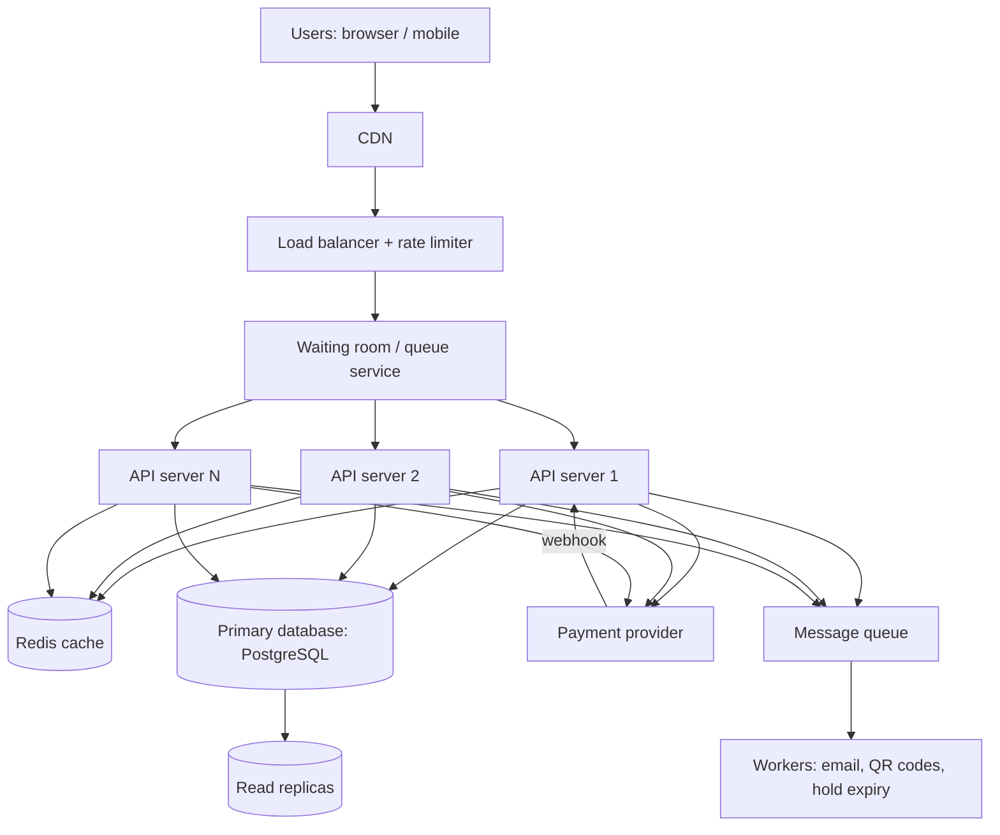

# TicketHub: Design Document

## Context

TicketHub is a website that sells tickets for concerts and events. It has 2 million registered users. On a normal day it is a quiet, read-heavy site: people browse events and a few buy tickets. A few times a year a very popular concert goes on sale, and for a few minutes the site faces a flood of people who all want the same seats.

The hard part is not the amount of data. It is making sure that, when thousands of people click at the same moment, **every seat is sold to exactly one person**, and that the site stays up and feels fair while it happens.

This document covers requirements, estimates, the API, the data model, how double-booking is prevented, the architecture, trade-offs, alternatives and risks.

### Goals

- Let users browse events, see seats, hold seats, pay and see their tickets.
- Never sell the same seat twice.
- Survive a "big sale" without crashing, and treat buyers fairly.

### Non-goals (deliberately not designed here)

- Organizer tools for creating events and seat maps (assume events and seats are loaded by an admin script).
- Resale or ticket transfer between users.
- Refund policies, recommendations and search ranking.
- Multi-region deployment.

---

## 1. Requirements

### Functional

1. A user can register, log in and log out.
2. A user can browse and search events by name, city and date.
3. A user can open an event and see its seat map: every seat's status (available, held or sold) and price.
4. A user can **hold** up to 4 seats for 10 minutes while paying.
5. A user can pay for the held seats; payment turns the hold into a confirmed order.
6. A user can view their orders and tickets (with a QR code) and gets a confirmation email.
7. If a hold expires or is cancelled, the seats go back on sale.

### Non-functional

| Quality | Requirement | Why |
|---|---|---|
| **Correctness** (most important) | A seat is **never** sold twice. A user is never charged without getting a ticket, or given a ticket without paying. | Selling a seat twice means angry customers, refunds and lost trust. This is worse than being slow. |
| **Speed** | Browsing pages under 300 ms (p95); seat map under 1 s; hold request under 500 ms, even during a big sale. | Slow pages make people leave, and in a sale every second counts. |
| **Fairness** | First come, first served during a sale. Maximum 4 seats per user per event. Bots and multiple tabs are limited. | 200,000 people want 20,000 seats; people must trust the process. |
| **Availability** | 99.9% for browsing. During a sale, slow down gracefully (waiting room) rather than crash. | A crash at sale time loses all revenue. |
| **Scalability** | Handle about 400x normal peak load for a few minutes. | See the estimates. |
| **Durability** | Orders and payments are never lost, even if a server crashes. | Customers need proof of purchase. |
| **Security** | Hashed passwords, HTTPS, card data handled only by the payment provider, signed QR codes. | Legal and trust reasons. |

If two requirements conflict, correctness wins over speed, and speed wins over feature richness.

---

## 2. Estimates

Given: 2,000,000 registered users; 50,000 visitors on a normal day, each viewing 10 pages; 5,000 tickets sold on a normal day; in a big sale 200,000 people try to buy 20,000 seats in the first 10 minutes.

### Normal day

| Item | Calculation | Result |
|---|---|---|
| Daily active share | 50,000 / 2,000,000 | 2.5% of users |
| Page views per day | 50,000 x 10 | 500,000 |
| Average page views/s | 500,000 / 86,400 | about 6/s |
| Peak page views/s | assume peak = 10x average | about 60/s |
| Orders per day | 5,000 tickets / about 2 per order | about 2,500 |
| Orders per second | 2,500 / 86,400 | about 0.03/s (peak about 0.3/s) |
| Read-to-write ratio | 500,000 views : 2,500 orders | about 200 : 1 (read-heavy) |
| Storage growth | 5,000 tickets/day x 365 x about 300 bytes | about 0.5 GB/year |

### Big sale

Assumptions: the window is 600 s; half of the 200,000 people arrive in the first minute; each user makes about 15 requests (event page, seat map, about 10 seat-map refreshes, about 3 hold attempts).

| Item | Calculation | Result |
|---|---|---|
| Average arrivals | 200,000 / 600 | about 333 users/s |
| Arrivals in first minute | 100,000 / 60 | about 1,700 users/s |
| Total requests | 200,000 x 15 | 3,000,000 |
| Average request rate | 3,000,000 / 600 | about 5,000/s |
| **Peak request rate** | 100,000 x 15 / 60 | about **25,000/s** |
| Hold attempts (writes) | 200,000 x 3 / 600 | about 1,000/s average, about 5,000/s at peak |
| Competition | 200,000 / 20,000 | **10 people per seat** |

### Comparison

| | Normal peak | Big sale peak | Ratio |
|---|---|---|---|
| Requests per second | about 60 | about 25,000 | **about 400x** |
| Writes per second | about 0.3 | about 5,000 | **over 10,000x** |
| Pattern | spread over the day | mostly in the first minute | spike |
| Contention | almost none | 10 buyers per seat | extreme |

### What the numbers tell us

1. Design for the spike, not the average. A normal day is trivial for one server and one database.
2. Data size is irrelevant (0.5 GB/year). The problem is **concurrency**: thousands of writes aimed at the same 20,000 rows.
3. Reads (seat map refreshes) are the bulk of the traffic and can be cached. Writes (holds) cannot be cached, because they must be correct. So effort goes to protecting the write path.
4. 90% of the people will not get a seat, so how we handle waiting and failing is part of the design.

---

## 3. API

REST over HTTPS with JSON. All endpoints except login and browsing need `Authorization: Bearer <token>`. Money is in cents.

| # | Method and path | Purpose |
|---|---|---|
| 1 | `POST /auth/login` | Log in, receive a token |
| 2 | `GET /events?city=&date=&q=&page=` | Browse and search events (public, cacheable) |
| 3 | `GET /events/{eventId}` | Event details (public, cacheable) |
| 4 | `GET /events/{eventId}/seats` | View seats and their status (cached 1 to 2 s during a sale) |
| 5 | `POST /events/{eventId}/holds` | Hold seats for 10 minutes |
| 6 | `DELETE /holds/{holdId}` | Release a hold early |
| 7 | `POST /orders` | Pay for a hold and create the order |
| 8 | `GET /orders/{orderId}` | Order status |
| 9 | `GET /me/tickets` | View my tickets |

`POST` endpoints that spend money or seats (5 and 7) require an `Idempotency-Key` header, so a double-click or a network retry cannot charge twice or create two orders.

### Examples

**View seats:** `GET /events/42/seats` returns `200 OK`

```json
{
  "eventId": 42,
  "asOf": "2026-11-01T18:00:02Z",
  "seats": [
    {"id": 9001, "section": "A", "row": "1", "number": 1, "priceCents": 15000, "status": "AVAILABLE"},
    {"id": 9002, "section": "A", "row": "1", "number": 2, "priceCents": 15000, "status": "HELD"},
    {"id": 9003, "section": "A", "row": "1", "number": 3, "priceCents": 15000, "status": "SOLD"}
  ]
}
```

**Hold seats:** `POST /events/42/holds`, body `{"seatIds": [9001, 9005]}`

| Status | Meaning | Body |
|---|---|---|
| `201 Created` | Both seats held | `{"holdId": "h_77", "seatIds": [9001, 9005], "expiresAt": "2026-11-01T18:10:05Z"}` |
| `409 Conflict` | At least one seat is taken; **nothing** is held | `{"error": "SEAT_UNAVAILABLE", "seatIds": [9005]}` |
| `422 Unprocessable` | More than 4 seats requested | `{"error": "TOO_MANY_SEATS"}` |
| `429 Too Many Requests` | Rate limit or waiting room | `{"error": "WAIT_IN_QUEUE"}` |

**Pay:** `POST /orders`, body `{"holdId": "h_77", "paymentToken": "tok_abc"}`

| Status | Meaning |
|---|---|
| `201 Created` | Paid. Returns `{"orderId": 5501, "status": "PAID"}` |
| `402 Payment Required` | Card declined. The hold stays until it expires, so the user can retry |
| `410 Gone` | The hold expired and the seats are no longer reserved |

---

## 4. Data model

A relational database (PostgreSQL), because we need transactions and constraints for correctness.

```
users 1 --- * orders 1 --- * tickets * --- 1 event_seats * --- 1 events
                |
                * payments
users 1 --- * event_seats   (held_by: who currently holds a seat)
events 1 --- * orders
```

**users**: `id` PK, `email` NOT NULL **UNIQUE**, `password_hash` NOT NULL, `name`, `created_at`.

**events**: `id` PK, `name`, `venue`, `city` (indexed), `starts_at` (indexed), `sale_starts_at`, `total_seats`.

**event_seats** (one row per seat per event; this is the inventory):

| Column | Notes |
|---|---|
| `id` | PK |
| `event_id` | FK to events.id |
| `section`, `row_label`, `seat_number` | where the seat is |
| `price_cents` | NOT NULL |
| `status` | `AVAILABLE`, `HELD` or `SOLD` (CHECK constraint on allowed values) |
| `held_by` | FK to users.id, NULL unless held |
| `hold_id` | groups the seats of one hold, NULL unless held |
| `hold_expires_at` | NULL unless held |
| constraint | **UNIQUE** (event_id, section, row_label, seat_number): a physical seat exists once per event |
| constraint | **CHECK** that `status = 'HELD'` exactly when `held_by` and `hold_expires_at` are set |

**orders**: `id` PK, `user_id` FK, `event_id` FK, `status` (`PENDING`, `PAID`, `FAILED`, `REFUNDED`), `total_cents`, `idempotency_key`, `created_at`. Constraint: **UNIQUE** (user_id, idempotency_key).

**tickets** (one row per seat actually sold): `id` PK, `order_id` FK, `event_seat_id` FK **UNIQUE**, `qr_code` (signed token). The UNIQUE constraint on `event_seat_id` is the final safety net: a seat can appear on at most one ticket, ever.

**payments**: `id` PK, `order_id` FK, `provider_ref`, `amount_cents`, `status` (`AUTHORIZED`, `CAPTURED`, `FAILED`).

### Relationships

- One user has many orders (1 : N). One event has many seats (1 : N).
- One order has many tickets (1 : N) and one or more payment attempts (1 : N).
- Each ticket points to exactly one event seat (1 : 1, enforced by UNIQUE).

---

## 5. How double-booking is prevented

The rule: **the database, not the application code, decides who gets a seat, and it does so atomically.** We run many API servers in parallel, so "read the seat, see it is free, then write it" in application code is a race condition: two servers can both read "free" at the same moment and both write.

### Step 1: Hold with one atomic conditional UPDATE

```sql
BEGIN;

UPDATE event_seats
SET status = 'HELD', held_by = :userId, hold_id = :holdId,
    hold_expires_at = now() + interval '10 minutes'
WHERE id = ANY(:seatIds)          -- seat ids sorted ascending
  AND event_id = :eventId
  AND ( status = 'AVAILABLE'
        OR (status = 'HELD' AND hold_expires_at < now()) );

-- rows updated = number of seats requested?  yes -> COMMIT
--                                            no  -> ROLLBACK, return 409
```

- The check ("is it free?") and the write ("take it") are **one statement**, so there is no gap for another request to slip into.
- If two users go for the same seat, PostgreSQL locks the row for the first UPDATE. The second waits, then re-checks the `WHERE` condition against the new row: the seat is now held and not expired, so **0 rows match** and the second user gets `409`. Exactly one wins, and the loser always knows.
- **All or nothing:** if only some of the requested seats were updated, we roll back, so nobody receives a half-booking.
- **No deadlocks:** seat ids are always sorted before updating, so two users with overlapping seats lock them in the same order.

### Step 2: Confirm the purchase in one transaction

```sql
BEGIN;
-- 1. Re-check that I still own a valid hold
SELECT id FROM event_seats
 WHERE hold_id = :holdId AND held_by = :userId
   AND status = 'HELD' AND hold_expires_at > now()
 FOR UPDATE;                       -- fewer rows than expected -> ROLLBACK

-- 2. Create the order and tickets
INSERT INTO orders  (...) VALUES (...);          -- UNIQUE (user_id, idempotency_key)
INSERT INTO tickets (order_id, event_seat_id, ...) VALUES (...);  -- UNIQUE (event_seat_id)

-- 3. Mark the seats as sold
UPDATE event_seats SET status = 'SOLD', held_by = NULL, hold_expires_at = NULL
 WHERE hold_id = :holdId;
COMMIT;
```

The transaction is **atomic** (all or nothing), so there is never a ticket without a sold seat, or a sold seat without a ticket. It is **isolated**, so other transactions never see half-finished work.

### Step 3: Constraints as a safety net

Even if the code has a bug, the database refuses invalid data:

- `UNIQUE (event_seat_id)` on `tickets`: a second ticket for the same seat fails and the transaction rolls back. **Double-selling is impossible at the storage level.**
- `CHECK` on `event_seats`: a seat cannot be held without an owner and an expiry.
- `UNIQUE (user_id, idempotency_key)` on `orders`: retries cannot create a second order.

### Step 4: Expiry and edge cases

- Hold expiry uses the **database clock** (`now()`), never the user's or the server's.
- A background job every 30 seconds frees expired holds so the seat map stays accurate. Even if the job is late, Step 1's `WHERE` clause lets a new buyer take an expired hold.
- **Payment starts, then the hold expires:** while a payment is in progress we extend the hold by 2 minutes. If the seat is still lost, the Step 2 transaction fails and we automatically void or refund the payment, so nobody is charged without a ticket.

### Why not the obvious alternatives?

- **Check in application code:** race condition, as described above.
- **Locks in the application servers:** servers do not share memory, so one cannot see another's lock.
- **Redis as the source of truth:** fast, but if Redis loses data or fails over, a seat could be sold twice. See "Alternatives considered".

---

## 6. Architecture

### How the design grows, one problem at a time

We start with the simplest design that works, then ask where the numbers say it breaks.

**Start:** one app server and one database. A request arrives, the server checks the seat in the database, updates it and responds. This is enough for a normal day (60 requests/s, 0.3 orders/s).

| # | Problem (from the estimates) | Component added | New problem it creates |
|---|---|---|---|
| 1 | Images and event pages are re-sent on every visit. | **CDN** | Cached pages can be slightly out of date. |
| 2 | One server cannot handle 25,000 requests/s, and it is a single point of failure. | **Load balancer + several stateless API servers** | Servers must keep no state in memory (state lives in the database/cache), and more servers cost more. |
| 3 | The seat map is refreshed constantly and overwhelms the database. | **Redis cache** for events and the seat map | The seat map can be 1 to 2 seconds stale. |
| 4 | 200,000 people at once means thousands of hold writes per second on 20,000 hot rows. | **Waiting room (virtual queue)** + rate limiter | More complexity; people must wait. |
| 5 | Slow work (emails, QR codes, expiring holds) must not slow the sale. | **Message queue + workers** | Work happens a little later, and failed jobs must be retried. |
| 6 | Browsing, search and "my tickets" compete with sale writes on one database. | **Read replicas** | Replicas lag slightly behind the primary. |

### Final architecture



### What each component does

| Component | Role | Why it is there |
|---|---|---|
| **CDN** | Serves images, scripts and cached public pages from servers near the user. | Removes most of the 25,000 requests/s from our servers. |
| **Load balancer + rate limiter** | Spreads requests over the API servers; limits requests per user and per IP; blocks obvious bots. | Avoids one overloaded server and stops one person from flooding the system (fairness). |
| **Waiting room** | During a sale, users get a place in line (by arrival time) and are admitted gradually with a signed pass. | Protects the database from 200,000 simultaneous users and gives everyone a visible, fair position instead of an error page. |
| **API servers (stateless)** | Run the logic behind the API in section 3. | Can be added before a sale and removed afterwards (auto-scaling). |
| **Redis cache** | Holds event pages, the seat map (refreshed every 1 to 2 s), queue positions and rate-limit counters. | Keeps the most common request (seat map) off the database. |
| **Primary database (PostgreSQL)** | Stores users, events, seats, orders, tickets, payments; takes **all writes**; enforces transactions and constraints. | The single source of truth, and where double-booking is prevented (section 5). |
| **Read replicas** | Copies of the database. | Serve search and "my tickets" without loading the primary. |
| **Payment provider** | External card processing. We receive a token and a webhook with the result. | Security and compliance: we never see card numbers. |
| **Message queue + workers** | Send confirmation emails, create QR codes, release expired holds, retry failed webhooks. | The user's request returns quickly; slow work happens in the background and can be retried. |

### How it survives the big sale

1. **Reads never reach the database.** Of the roughly 25,000 requests/s at peak, most are page loads and seat-map refreshes. The CDN and Redis answer them.
2. **The waiting room shapes the writes.** Assume it admits about 100 users/s. Each admitted user makes about 3 hold attempts, so the primary sees about 300 hold writes/s instead of 5,000. Admitted buyers take about 2 seats each, so 20,000 seats are gone after roughly 100 s of admissions, and the people still waiting are told clearly that the event is sold out.
3. **Each write is short.** A hold is one small UPDATE on a few rows, with no long transaction. Contention on a seat only delays the few people fighting for that seat.
4. **Payment never holds database locks.** The hold (a row state with an expiry) reserves the seat while the user pays.
5. **Slow work is asynchronous**, so emails and QR codes cannot slow the sale.
6. **Preparation:** API servers are scaled up before the announced start time, and we load-test at 25,000 requests/s beforehand.
7. **Graceful failure:** if the system is overloaded, the waiting room slows admission instead of letting the site crash. If the cache fails, reads fall back to the replicas (slower), and correctness is unaffected because it lives in the primary database. If an API server dies mid-purchase, nothing is lost: the hold and order are in the database, and an unfinished hold just expires.

---

## 7. Trade-offs

### 1. Database transactions vs. a faster in-memory store

- **Choice:** Seat ownership is decided by a PostgreSQL transaction on the primary.
- **Gain:** Correctness. Double-booking is impossible, even after crashes.
- **Give up:** One primary is harder to scale for writes than Redis. That is why we added the waiting room to cap the write rate.
- **Why acceptable:** About 300 holds/s is easy for a tuned primary, and selling a seat twice is far worse than being slightly slower.

### 2. Slightly stale seat map vs. always-fresh data

- **Choice:** The seat map is cached for 1 to 2 seconds.
- **Gain:** Thousands of refreshes per second become about one database query per second per event.
- **Give up:** A user may click a seat that was just taken and get `409`.
- **Why acceptable:** The hold step always checks the real database, so a stale map can never cause a wrong sale, only a minor annoyance. The `409` response includes the current seat status so the screen updates.

### 3. Fairness and protection (waiting room) vs. simplicity and speed for the user

- **Choice:** A virtual queue admits users gradually.
- **Gain:** The site survives and everyone gets an ordered, visible place.
- **Give up:** More components to build and run, and people wait even when the system might have coped. People will try multiple tabs or bots, so we limit passes per account and per IP.
- **Why acceptable:** A predictable wait is better than a crashed site for 200,000 people.

### 4. Length of the hold (10 minutes)

- **Short hold:** seats return to sale quickly, but slow payers lose their seats.
- **Long hold:** comfortable for users, but abandoned holds block real buyers when seats are scarce.
- **Choice:** 10 minutes, extended by 2 minutes while a payment is in progress, with a maximum of 4 seats per user.

---

## 8. Alternatives considered

| Alternative | Why it was not chosen |
|---|---|
| **`SELECT ... FOR UPDATE`, then check in code, then UPDATE** | Also correct, but takes more round trips and holds locks longer. The single conditional UPDATE does the same job in one step. |
| **Redis holds as the source of truth** (atomic `SET NX` with expiry) | Very fast, but a Redis failure or failover could lose holds and allow double-selling. Redis is used only for caching and queues. |
| **Optimistic locking with a `version` column** | Works, but under 10-to-1 competition most attempts would fail and retry, wasting work. The conditional UPDATE lets the database serialize the competition directly. |
| **Sharding the database by event** | Not needed: storage is tiny and a single primary can handle the capped write rate. It would add complexity for no gain now. |
| **First-click-wins with no waiting room** | Simplest, but 100,000 people in one minute would overload the system and favor people with the fastest connections and bots. |

---

## 9. Risks and open questions

**Risks**

- **Bots** may buy seats faster than humans. Mitigations: rate limits, one pass per account, bot detection, a 4-seat limit. The risk is reduced, not removed.
- **Payment provider is slow or down** during the sale. Holds expire and buyers lose seats. Mitigation: the 2-minute extension while a payment is in progress, plus clear messages.
- **The hot rows of one event** could become a bottleneck if our estimate of writes is too low. Mitigation: load tests before sales, and the waiting room's admission rate can be lowered.
- **Webhook arrives twice or late.** Orders are idempotent (`UNIQUE` on the idempotency key), so processing twice is harmless.

**Open questions**

- What is the right admission rate for the waiting room? It needs to be tuned by load testing.
- Should a user be allowed several events in the same sale window, or only one at a time?
- Should failed buyers get a "notify me if seats are released" option?
- How long should we keep expired holds in logs for dispute handling?
